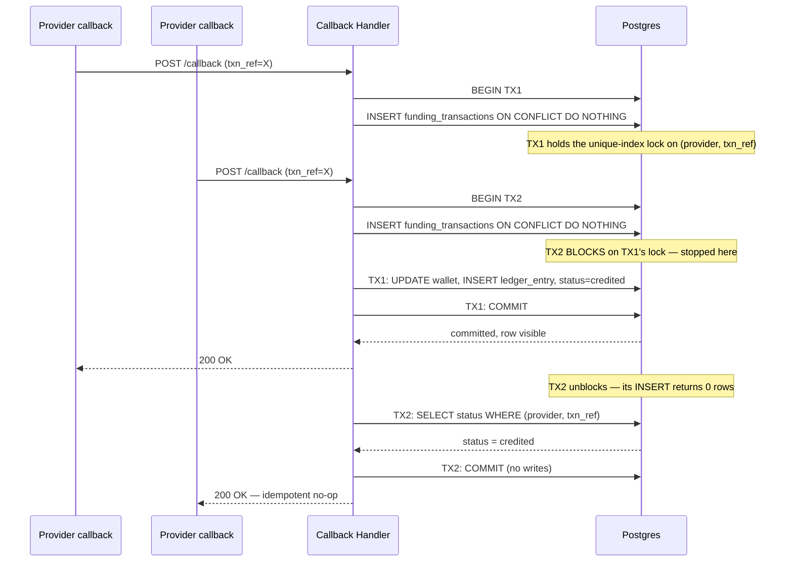

# CTO / VP Engineering — Take-Home Submission

---

## Part A — Growing Into Two New Markets Without Breaking How We Handle Money

**To:** CEO, Engineering Leads
**From:** Incoming CTO / VP Engineering
**Re:** Our plan for the next 6 months

### 1. Build once, stop copy-pasting

Today, every time we enter a region we copy our entire system and run it as its own separate version. Three regions means three copies, slowly drifting apart — different settings, different quirks, different bugs. That's why region 3 took four months instead of six weeks.

**The call:** stop copying the whole system. Build one shared "engine room" for the most sensitive part of the business — moving and tracking money — and have every region plug into that *same* engine instead of running its own copy. Everything customer-facing — branding, local promotions, local look-and-feel — stays flexible per region, because that's supposed to differ brand to brand.

**The cost, honestly:** changing the money engine while the business keeps running is like swapping a plane's engine mid-flight. We won't do it recklessly — we'll run the new engine quietly alongside the old one, prove it gives identical answers, then switch regions over one at a time. Slower than just copying region 4, and we're choosing that trade-off on purpose, because copying is what's already causing our incidents.

### 2. One rulebook, local exceptions allowed

One region's settings file has ballooned to 25,000 lines because nobody reuses a shared starting point — every region rewrites everything from scratch. We'll give every region one shared rulebook with sensible defaults; regions only write down what's *different* about them. New regions start clean and small; existing ones get cleaned up as part of this same project, not a separate effort later.

### 3. Payments: build our own toolkit, rent speed for now

We have 100+ hand-built connections to payment companies, each taking a senior engineer 2-3 weeks — our biggest drain on senior talent, and it only grows as we add markets and brands.

Two things, in parallel: we start building our own reusable toolkit so future payment connections are faster and cheaper to build. But that toolkit won't be ready in time to carry the two markets we've already committed to — so for those two, we partner with an outside payments specialist who already has the local connections built, to protect the deadline. We fold those into our own toolkit later, once both launches are stable.

### 4. The team should match the new plan, not the old one

Today, knowledge about how money moves through our system lives in the heads of a handful of senior engineers — exactly why mistakes happen when they're stretched thin. We'll create one dedicated team that owns the shared money engine and writes down what's currently only in people's memory. A second, temporary team gets the two new markets live. Our data/reporting team and brand-facing teams keep doing exactly what they're doing — nothing changes there.

If this doesn't match how the org chart looks today, we change the org chart, not the plan — today's setup is part of why we have incidents.

### 5. The six-month plan — and what we'll deliberately skip

| When | What happens |
|---|---|
| Months 1–2 | Stop copying regions. Start the new team. Agree on the shared rulebook and the shared payments toolkit's design. Line up the outside payments partner for the two new markets. |
| Months 3–4 | Shared money engine goes live in our first region after being tested side-by-side. First new market launches, built clean from day one. |
| Months 5–6 | Remaining regions move to the shared engine. Second new market launches. |

**What we will deliberately NOT do in these 6 months:**
- Rebuild the parts of the system that are allowed to differ by brand — look and feel, promotions.
- Touch our data/reporting platform. It works; leave it alone.
- Try to force all old regions to match perfectly — just stop the gap from growing.
- Switch all regions over at once — one at a time, carefully checked.
- Reorganize anything beyond the one new team until we've proven the approach, around month 3.

### 6. Three ways this could go wrong

1. **The switch-over itself causes a money mistake.** Safeguard — we don't flip the switch until the new engine and old engine agree on every number, with zero exceptions.
2. **A new market's local payment method isn't ready in time.** Safeguard — by month 2, every payment method either works through our outside partner or is actively being built; if not, we escalate immediately rather than hope it catches up.
3. **The same few senior people are needed everywhere at once.** Safeguard — if the same names are blocking both the engine work and the new launches in the same week, we add people or cut scope, not push harder.

---

## Part B — Hands-On: Exactly-Once Wallet Crediting

A payment provider delivers a duplicate or delayed success callback. This is the mechanism that makes crediting exactly-once regardless of provider behavior.

### 1. Schema

```sql
CREATE TABLE funding_transactions (
    id                      UUID PRIMARY KEY DEFAULT gen_random_uuid(),
    wallet_id               UUID NOT NULL REFERENCES wallets(id),
    provider                TEXT NOT NULL,
    provider_transaction_id TEXT NOT NULL,
    amount_minor_units      BIGINT NOT NULL,      -- integer minor units, never float
    currency                TEXT NOT NULL,
    status                  TEXT NOT NULL DEFAULT 'pending', -- pending | credited | failed
    raw_payload             JSONB NOT NULL,
    created_at              TIMESTAMPTZ NOT NULL DEFAULT now(),
    updated_at              TIMESTAMPTZ NOT NULL DEFAULT now(),
    UNIQUE (provider, provider_transaction_id)     -- duplicate-killer
);

CREATE TABLE wallets (
    id                  UUID PRIMARY KEY DEFAULT gen_random_uuid(),
    player_id           UUID NOT NULL,
    balance_minor_units BIGINT NOT NULL DEFAULT 0, -- cached, derivable from ledger
    currency            TEXT NOT NULL,
    updated_at          TIMESTAMPTZ NOT NULL DEFAULT now()
);

CREATE TABLE ledger_entries (                       -- append-only, source of truth
    id                      UUID PRIMARY KEY DEFAULT gen_random_uuid(),
    wallet_id               UUID NOT NULL REFERENCES wallets(id),
    funding_transaction_id  UUID NOT NULL REFERENCES funding_transactions(id),
    entry_type              TEXT NOT NULL,           -- credit | debit | correction
    amount_minor_units      BIGINT NOT NULL,
    created_at              TIMESTAMPTZ NOT NULL DEFAULT now(),
    UNIQUE (funding_transaction_id)                  -- at most one ledger entry per txn
);
```

Two unique constraints — `(provider, provider_transaction_id)` and `ledger_entries.funding_transaction_id` — are the entire exactly-once mechanism.

### 2. Sequence diagram — duplicate and concurrent callbacks



The duplicate is stopped by the row already existing; the concurrent case is stopped earlier — the unique index forces the second transaction to block until the first resolves, so there's no window where both believe they're first.

### 3. Pseudo-code — callback handler

```
function handleCallback(payload):
    walletId = resolveWallet(payload)

    BEGIN TRANSACTION   -- single boundary: insert, credit, ledger all-or-nothing

        row = EXEC(
            "INSERT INTO funding_transactions
                (wallet_id, provider, provider_transaction_id, amount_minor_units, currency, raw_payload)
             VALUES ($1,$2,$3,$4,$5,$6)
             ON CONFLICT (provider, provider_transaction_id) DO NOTHING
             RETURNING id"
        )

        if row is empty:                      -- duplicate, or lost the lock race
            existing = EXEC("SELECT status FROM funding_transactions
                              WHERE provider=$1 AND provider_transaction_id=$2", ...)
            COMMIT
            return 200 OK                      -- idempotent: already handled

        -- single winner for this provider_transaction_id
        EXEC("UPDATE wallets SET balance_minor_units = balance_minor_units + $1,
              updated_at = now() WHERE id = $2", payload.amount, walletId)

        EXEC("INSERT INTO ledger_entries (wallet_id, funding_transaction_id, entry_type, amount_minor_units)
              VALUES ($1,$2,'credit',$3)", walletId, row.id, payload.amount)

        EXEC("UPDATE funding_transactions SET status='credited', updated_at=now() WHERE id=$1", row.id)

    COMMIT
    return 200 OK
```

No check-then-insert in application code — the uniqueness check *is* the insert, enforced by the database, so there's no gap for a race to live in.

### 4. Brief answers

**Crash after commit, before the provider receives the 200:** harmless. The transaction already committed — status is `credited`, wallet and ledger are updated. The provider retries on no-200; the retry's insert conflicts, the handler reads back `credited`, returns 200, no further writes. Idempotency lives in committed state, not in whether a response was delivered.

**Detecting residual drift:** a scheduled job compares each wallet's `balance_minor_units` against `SUM(ledger_entries.amount_minor_units)`. Any mismatch is drift — no tolerance band, because amounts are integer minor units, not floats (the float-rounding incident is itself the argument against ever storing money as floating point). On drift: freeze the wallet from further debits, page on-call, diff against `funding_transactions` to localize the transaction. The fix is always an appended correcting `ledger_entries` row, never an `UPDATE` to history.

---

## AI tool disclosure

Drafted with Claude (Anthropic) as a thinking/writing partner: structuring the memo, drafting prose, generating schema/pseudo-code/sequence diagram, and stress-testing the architecture for consistency across both parts. Positions, trade-offs, and sequencing are mine; I can defend each decision and its failure modes in discussion.
